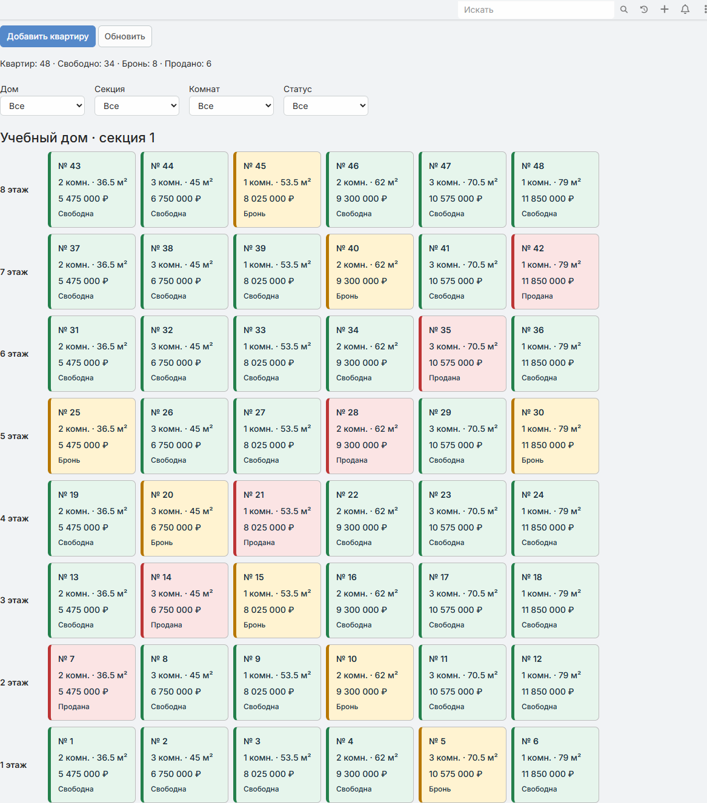

# Домашнее задание: Docker, EspoCRM и шахматка квартир

Результат: локально развёрнута **EspoCRM 10.0.11** в Docker и добавлен раздел для продажи квартир — **«Шахматка квартир»**. Дополнительно выполнено отдельное задание по установке пяти MCP-серверов.



## Выполненные задания

| Задание | Результат |
| --- | --- |
| Установить Docker | Установлен Docker Desktop, включена аппаратная виртуализация, работает WSL 2 |
| Развернуть CRM | EspoCRM и MariaDB запущены через Docker Compose; настроены фоновые задачи и WebSocket |
| Добавить функцию под бизнес | Реализована шахматка квартир внутри EspoCRM с сохранением данных в её базе |
| Подготовить демонстрацию | Загружены 48 учебных квартир: 34 свободны, 8 в брони, 6 проданы |
| Установить MCP-серверы | Отдельно установлены Chrome DevTools, Firecrawl, Context7, Perplexity и Playwright; подробности ниже |
| Подготовить проект к сдаче | Исходники, инструкция, скриншот и отчёт; пароли вынесены в локальный `.env` и исключены из Git |

## Шахматка квартир

- Группировка по дому, секции и этажу, этажи сверху вниз.
- Статусы: **Свободна**, **Бронь**, **Продана** — с цветом и текстом.
- Фильтры по дому, секции, количеству комнат и статусу.
- Счётчики квартир и статусов для текущей выборки.
- Переход из плитки в карточку квартиры, добавление и редактирование.
- Поля: номер, этаж, комнаты, площадь, цена в рублях, покупатель из контактов CRM, примечание.
- Изменения сохраняются в базе CRM; после обновления шахматки меняются цвет и счётчики.
- Компоновка адаптируется к узкому экрану.

Это учебная реализация: автоматическое снятие брони и защита от одновременного бронирования несколькими менеджерами не реализованы. Все примеры вымышлены.

## Отдельное задание: MCP-серверы

Пять серверов установлены пользователем отдельно от развёртывания CRM. Ниже разделены факт установки и проверки в сессии подготовки проекта.

| MCP-сервер | Назначение | Что подтверждено при подготовке проекта |
| --- | --- | --- |
| **Chrome DevTools** | Диагностика браузера: консоль, сеть, производительность | Подключение проверено: получен список вкладок и выполнена фоновая навигация; исходная проверка CRM выполнялась через Playwright |
| **Firecrawl** | Извлечение и сбор содержимого веб-страниц | Установлен отдельно со слов пользователя; в текущую сессию инструменты не загружены, работоспособность здесь не проверялась |
| **Context7** | Актуальная документация библиотек и платформ | Использован для документации EspoCRM и Docker, включая схему томов EspoCRM 10 |
| **Perplexity** | Поиск, исследования и проверка фактов в интернете | Инструменты доступны в среде; отдельная проверка вызовом в рамках этой работы не выполнялась |
| **Playwright** | Проверка пользовательских сценариев в браузере | Использован для проверки входа, фильтра, карточек, сохранения статуса, переходов и узкого экрана |

API-ключи, токены и личные конфигурации MCP в репозиторий не входят.

## Запуск на другом компьютере

Требования: Docker Desktop с работающим движком Linux-контейнеров, WSL 2 на Windows и включённая аппаратная виртуализация. Откройте PowerShell в папке проекта и выполните:

```powershell
powershell -NoProfile -ExecutionPolicy Bypass -File .\start-crm.ps1 -Demo
```

При первом запуске скрипт создаст локальный `.env` со случайными паролями, скачает образы, запустит CRM, установит расширение и добавит учебные квартиры. Если `.env` уже существует, скрипт его не перезаписывает. Для запуска без учебных квартир уберите `-Demo`.

Открыть: **http://localhost:8080/#Apartment**. Имя пользователя и пароль берутся из вашего локального `.env`: `ESPOCRM_ADMIN_USERNAME` и `ESPOCRM_ADMIN_PASSWORD`. Готовых паролей в репозитории нет.

Альтернатива автоматической генерации: скопировать `.env.example` в `.env` и заполнить пустые значения собственными паролями до первого запуска. Для уже установленной CRM изменение `.env` само по себе не меняет пароль в базе или профиле администратора.

Первый запуск может занять несколько минут. Проверить контейнеры:

```powershell
docker compose ps
docker compose logs --tail 50 espocrm
```

Для доступа с другого компьютера адрес `localhost` не подходит: ссылка выше открывает CRM только на машине, где она запущена. Репозиторий содержит исходники и инструкцию, а не публично размещённую CRM.

## Проверки результата

Проверено на локально запущенной CRM 27 октября 2026 года:

| Проверка | Результат |
| --- | --- |
| Контейнеры | Все четыре запущены; EspoCRM и MariaDB имеют статус `healthy` |
| Вход | Успешный вход под администратором |
| Учебные данные | Отображаются 48 квартир |
| Фильтр «Бронь» | Показывает 8 квартир |
| Изменение статуса | Запись сохраняется, цвет плитки и счётчик меняются |
| Возврат в шахматку | Работает без перезагрузки страницы |
| Узкий экран 390 px | Горизонтальной прокрутки нет |
| Повторный импорт примеров | Существующие учебные квартиры не дублируются |

После проверки изменения учебного статуса отменены: итоговые счётчики — **34 / 8 / 6**.

## Хранение и секреты

- Пароли находятся только в локальном `.env`; этот файл исключён через `.gitignore`.
- `.env.example` содержит только названия переменных и пустые значения паролей.
- Порты CRM опубликованы только на `127.0.0.1`.
- Базы, дампы, браузерные журналы и личные настройки среды не публикуются.
- Данные хранятся в постоянных томах Docker. Перезапуск контейнеров их сохраняет.

Остановка: `docker compose stop`. Повторный запуск: `docker compose start`.

**Не выполняйте `docker compose down -v`, если хотите сохранить данные.**

## Структура проекта

```text
docker-compose.yml   CRM, MariaDB, фоновые задачи и WebSocket
start-crm.ps1        Развёртывание и установка расширения
init-env.ps1         Создание локальных случайных паролей
.env.example         Пустой шаблон переменных окружения
extension/           Метаданные, модель, контроллеры и интерфейс шахматки
scripts/setup.php    Настройка меню и импорт учебных квартир
docs/images/         Скриншот результата
```

Учебный Compose обновлён для EspoCRM 10: данные, серверные расширения и клиентские расширения хранятся в отдельных томах. Скрипт ждёт завершения первоначальной установки перед перестройкой схемы расширения.

Основа решения: [Docker-развёртывание EspoCRM](https://docs.espocrm.com/administration/docker/installation/), [пользовательские сущности](https://docs.espocrm.com/development/custom-entity-type/) и [пользовательские представления](https://docs.espocrm.com/development/custom-views/).
